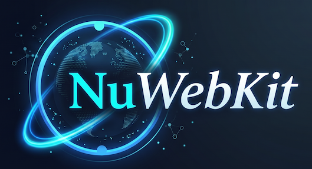

**Numerus NuWebKit** is a browser-based simulator designed for cellular, agent-based, and dynamical systems modeling, analysis, and simulation. Integrated into the Numerus ecosystem, the platform allows users to build and run computational models directly in a web browser. It provides accessible preset models that require no initial programming, while also featuring an AI window that enables users to modify existing frameworks or construct custom models from scratch. It is commonly used in educational and research environments to teach system dynamics and mathematical modeling concepts.

Visit the [NuWebKit client-side example models repository](https://nuwebkit.models.numerus.app/). Some are general audience examples of models as webapps, while others are demonstrations for specific audiences.

Compose your own agent-based, spatial and system dynamics models. Click to access to the [Designer](https://nuwebkit.models.numerus.app/common/designer/index1.html) authoring site, with access to source code from the model library available for reference.

**Numerus Documents**

* NuWebKit is documented in [Salter R and Getz WM (2026), *AI-enabled, user-modifiable, systems simulation web apps*, Front. Syst. Biol. 6:1964116. doi: 10.3389/fsysb.2026.1964116](https://www.frontiersin.org/journals/systems-biology/articles/10.3389/fsysb.2026.1964116/full).
* Additional documentation for NuWebKit can be found at [wiki.numerusinc.com](https://wiki.numerusinc.com/index.php/Main_Page).
* See also:
    * [The Numerus Midas SIRS App](https://www.numerusinc.com/midas/), a complete lesson in classic epidemiology.
    * [*Teaching dynamical systems modeling, analysis and simulation using a Lotka-Volterra Predation Narrative and a Numerus WebKit App*](https://ecoevorxiv.org/repository/view/15696/), companion to the [Numerus Webkit Dynamic Systems Simulator for Population Biology 1](https://nuwebkit.models.numerus.app/dynsslvpp/)

**User Guides and Tutorials for Designer and DynSS Programming**

* Programming ABMs and Cellular Automata is described in [NL API User Manual: Building Patch and Agent Models](https://nuwebkit.models.numerus.app/common/doc/).
* Programming system-dynamics models is described in [SD API User Manual: Building Stock-and-Flow Models](https://nuwebkit.models.numerus.app/common/doc/sd/).
* The NuML modeling language used by the DynSS apps is described in the [NuML User Manual](https://nuwebkit.models.numerus.app/common/doc/numl/).

